

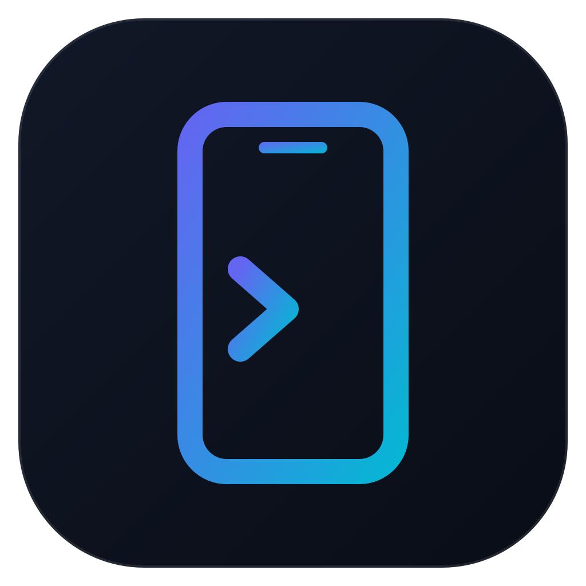

# ADB Companion

**The Android cockpit for your computer.**
Apps, files, terminal, Logcat, performance, screen mirroring and wireless connection:
all of ADB in a single window, without typing a single command.

[**Website & downloads**](https://alexcmb.github.io/adbcompanion-releases/en/) ·
[All releases](https://github.com/alexcmb/adbcompanion-releases/releases) ·
[FAQ](#faq) ·
[Français](README.md)

Windows · macOS · Linux — English and French interface

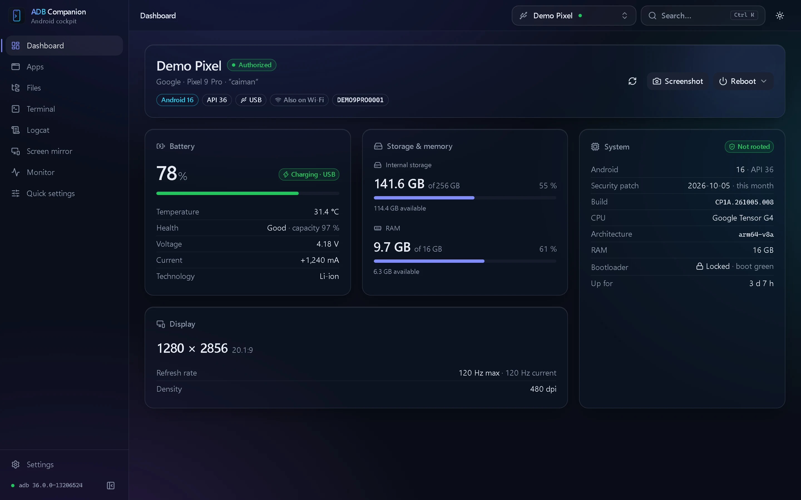

> [!NOTE]
> The screenshots on this page were made with fictitious demo devices.

## Contents

- [Features](#features)
- [Installation](#installation)
- [Getting started](#getting-started)
- [Tour](#tour)
- [Updates](#updates)
- [FAQ](#faq)

## Features

| | |
|---|---|
| **Dashboard** | Battery (level, health, temperature, current), storage, memory, display, Android version, security patch, CPU, bootloader and root status. Screenshots to save or copy, reboot to system, recovery, bootloader, fastbootd or EDL. |
| **Apps** | Full list with icons, sizes and filters (user, system, disabled, uninstalled). Install APK, APKS and XAPK (with OBB data) by drag and drop. Launch, force stop, disable, clear cache or data, uninstall, restore a system app. Bulk actions, editable permissions. |
| **Files** | Dual-pane computer ↔ device explorer over ADB's sync protocol. Tracked, cancellable transfers, conflict handling (replace, skip, keep both), preview, drag and drop from your file manager, root mode. |
| **Terminal** | Full interactive shell (colors, completion, resizing) in tabs, root tab, built-in and custom macros. |
| **Logcat** | Smooth live logs, filters by level, tag (with exclusions), app or regular expression, real pause, clear, export. |
| **Monitor** | Per-core CPU, memory, temperatures and battery in real time over 1 to 30 minutes. Process manager: sort, search, kill, free memory. |
| **Screen mirror** | View and control the device with [scrcpy](https://github.com/Genymobile/scrcpy), installed and configured for you: resolution, bit rate, codec, screen off, recording. Lighter profile over Wi-Fi, automatic fallback when the device's video encoder fails. |
| **Wireless** | Pairing by QR code or code, automatic device discovery, connect by address, one-click USB → Wi-Fi switch, automatic reconnection, unstable-connection indicator. A device plugged in over USB and Wi-Fi shows up only once. |
| **Quick settings** | Animation speed, display resolution and density, stay awake, show touches, private DNS, dark theme, force dark — with one-click restore of the original values. |
| **Comfort** | <kbd>Ctrl</kbd>+<kbd>K</kbd> command palette, notification area icon, connection notifications, ADB downloaded automatically if missing, dark or light theme with a glass effect, signed updates. |

## Installation

Download the right file for your system from the [website](https://alexcmb.github.io/adbcompanion-releases/en/#download) or the [releases page](https://github.com/alexcmb/adbcompanion-releases/releases):

| System | File | Notes |
|---|---|---|
| Windows 10 / 11 (64-bit) | `ADB.Companion_<version>_x64-setup.exe` | Recommended. Portable install: all data lives in the app's folder. |
| | `ADB.Companion_<version>_x64_fr-FR.msi` | For enterprise deployment. |
| macOS 11+ Apple Silicon | `ADB.Companion_<version>_aarch64.dmg` | M1 Macs and later. |
| macOS 11+ Intel | `ADB.Companion_<version>_x64.dmg` | |
| Linux x86_64 | `ADB.Companion_<version>_amd64.AppImage` | Any distribution. |
| | `.deb` / `.rpm` | Debian, Ubuntu… / Fedora, openSUSE… |

> [!IMPORTANT]
> The app isn't signed with a developer certificate yet.
> - **Windows**: SmartScreen shows "Windows protected your PC" → *More info* → *Run anyway*.
> - **macOS**: right-click the app → *Open*, then confirm.
>
> Updates, on the other hand, are signed and verified by the app before they're installed.

Nothing else to install: ADB Companion uses an existing ADB (Android SDK, `PATH`…) or offers to download Google's official Platform-Tools in one click.

## Getting started

1. On the Android device: **Settings → About phone**, tap **Build number** seven times to unlock *Developer options*.
2. In *Developer options*, turn on **USB debugging** (and **Wireless debugging** for Wi-Fi).
3. Plug the device in and accept the computer's key on its screen. It shows up in ADB Companion right away.

To go wireless: the **Switch to Wi-Fi** button on the dashboard of a USB-connected device, or **Wireless connection → QR code** and scan it from *Wireless debugging → Pair device with QR code* (Android 11 and later).

## Tour

### Apps

Install by drag and drop, act on one app or many at once.

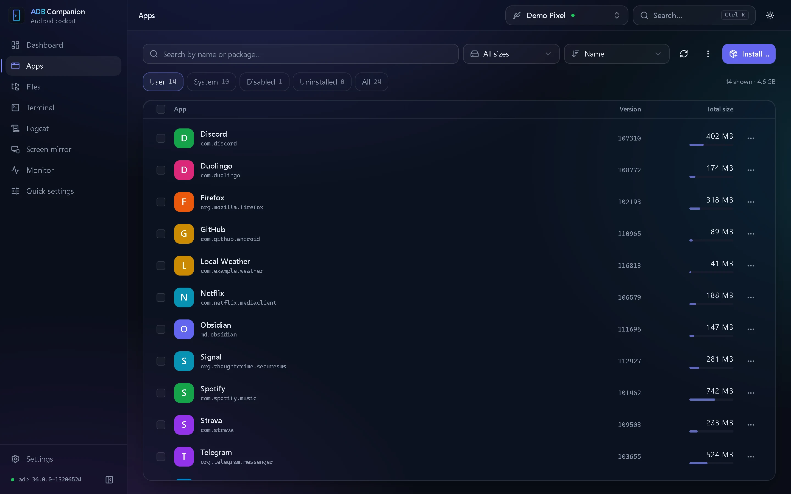

### Files

Two panes, fast and tracked transfers.

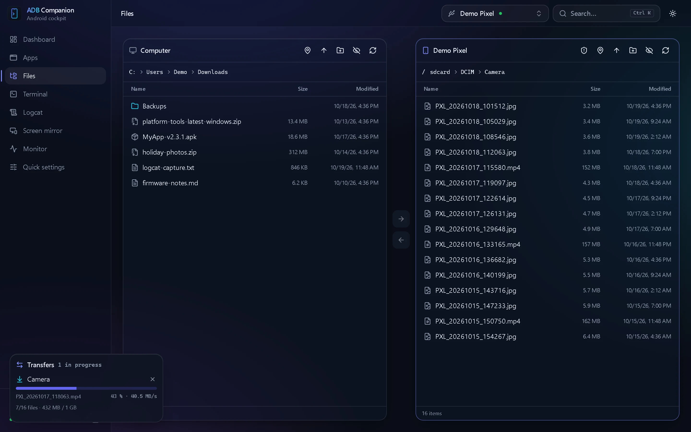

### Terminal

A real shell, in tabs, with macros.

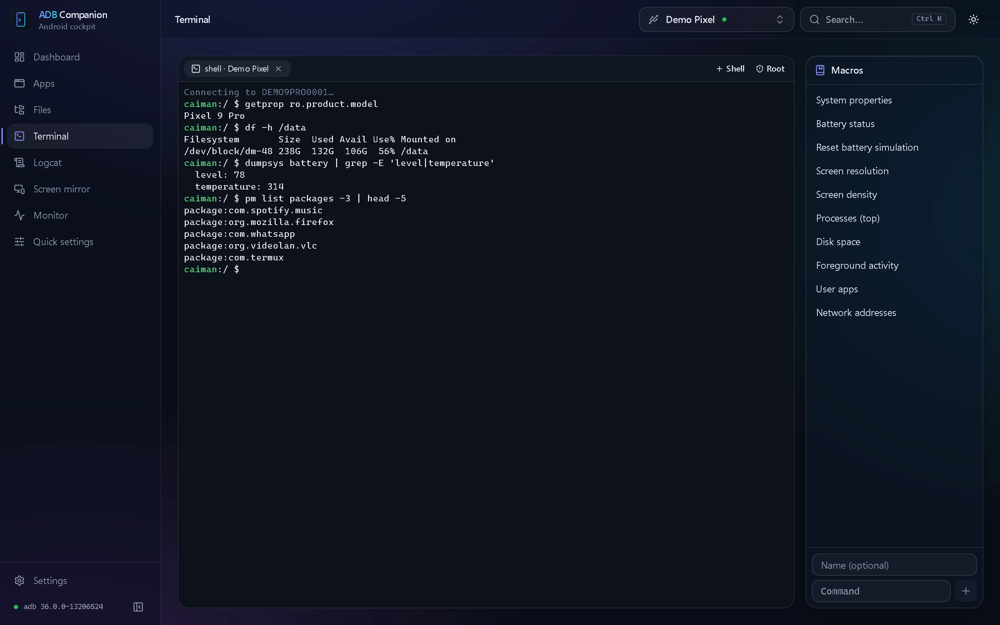

### Logcat

Readable logs even at high rates, filtered any way you like.

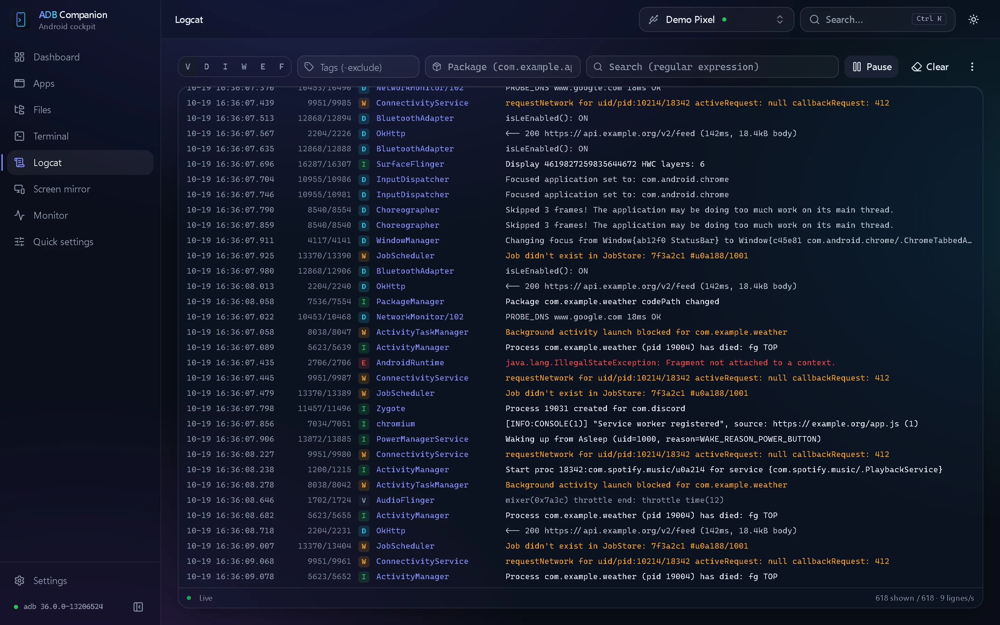

### Monitor

CPU, memory, temperatures and battery in real time.

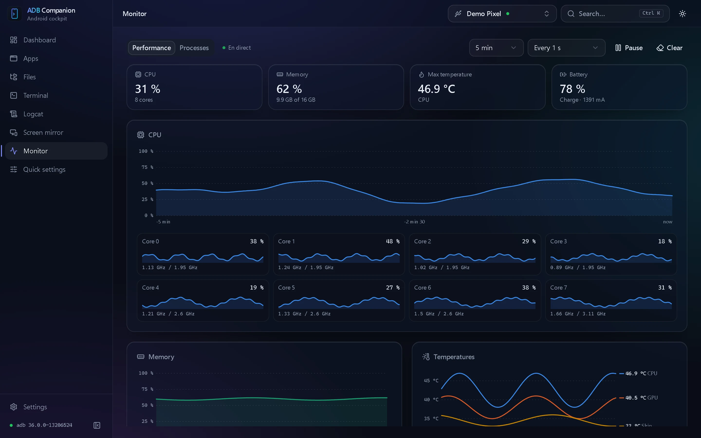

### Wireless connection

QR code pairing, no address or port to remember.

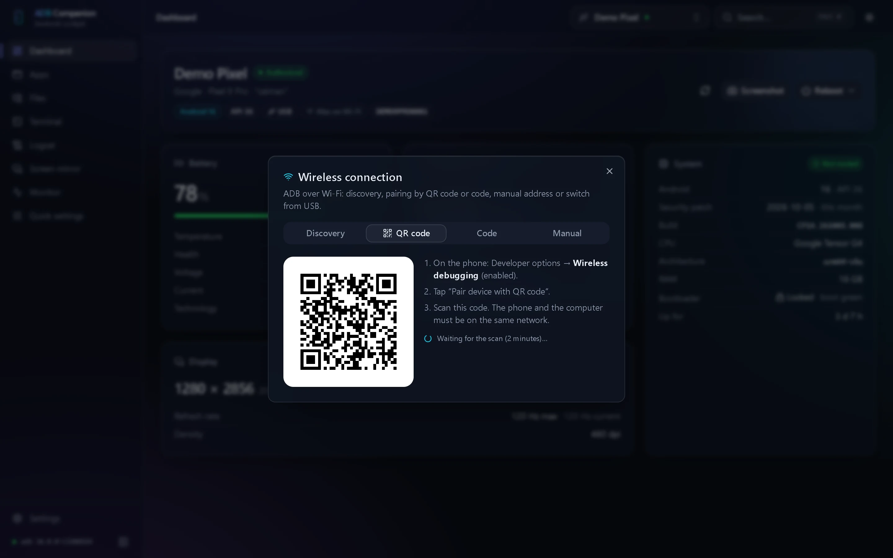

### Screen mirror

Your device's screen in a window, configured for you.

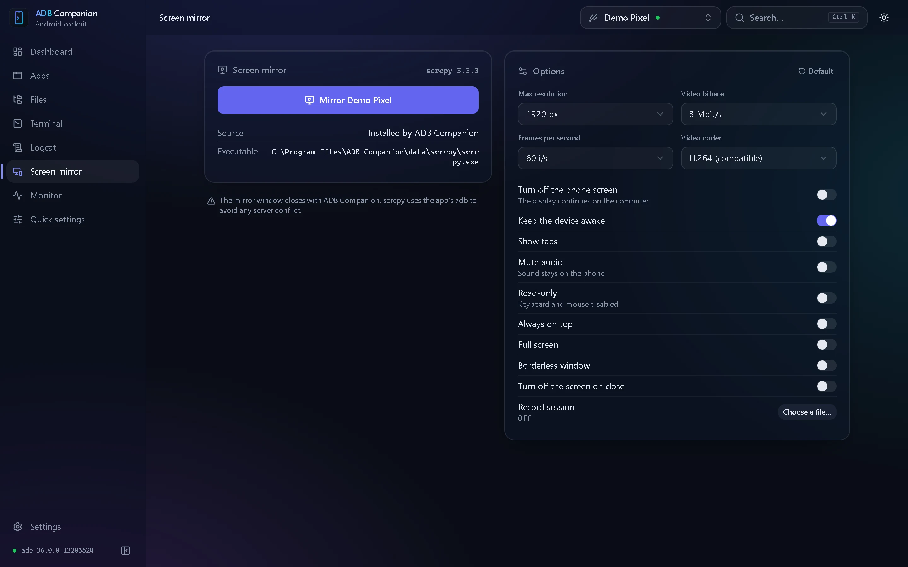

### Quick settings

Android's hidden options, with an undo.

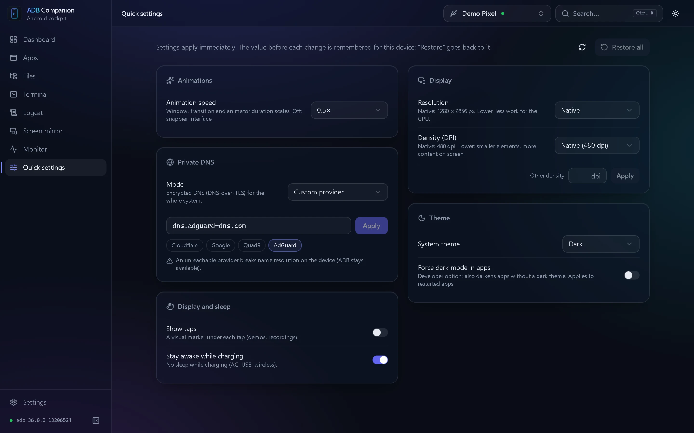

### Command palette and light theme

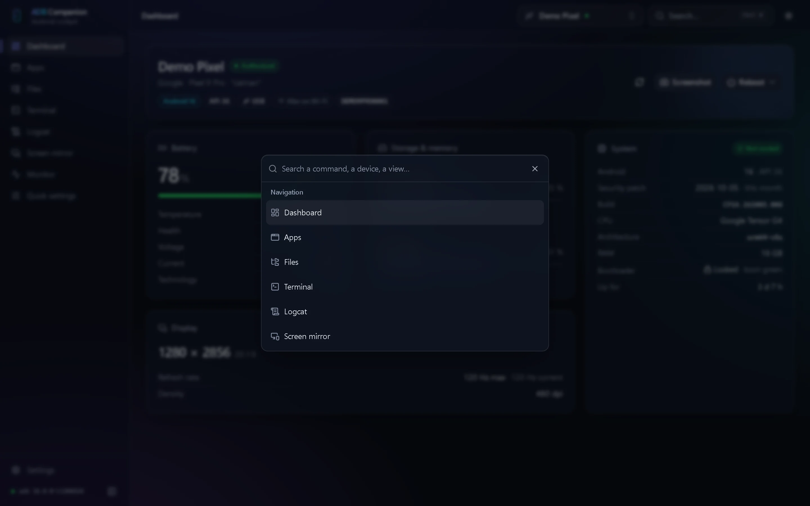 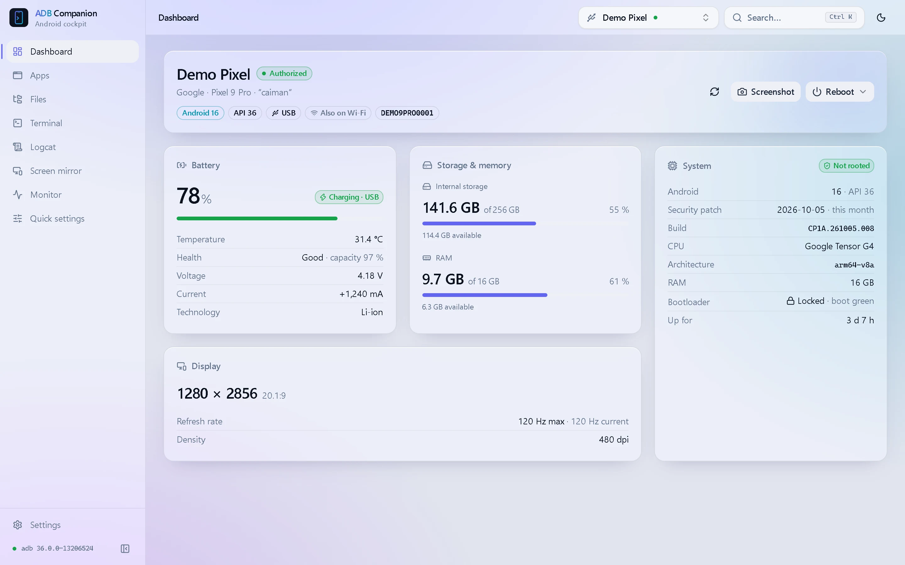

## Updates

ADB Companion checks for a new version at startup; nothing is installed without your consent, and every package is verified by signature.
In **Settings → Updates**, the **Experimental versions** option also gets you the pre-releases published for testing.

## FAQ

<b>Does my device need to be rooted?</b>

No. Root is only used for a few advanced features (browsing the whole file system, the terminal's root tab, clearing an app's cache), when your root manager grants it to the shell.

<b>Where is my data stored? Is anything sent anywhere?</b>

On Windows the install is portable: settings, logs and downloaded tools live in a `data` folder next to the app; the installer offers to remove it on uninstall.
The app sends no data. It only goes online to check for updates and, when you ask, to download ADB or scrcpy.

<b>Linux: the device doesn't show up over USB.</b>

Install your distribution's Android udev rules (often `android-udev-rules` or `android-sdk-platform-tools-common`), add your user to the group it names (`plugdev` or `adbusers`), then plug the device in again.

<b>The device shows up as "unauthorized".</b>

Unlock the device and accept the "Allow USB debugging?" prompt. If it doesn't appear, revoke USB debugging authorizations in *Developer options*, then plug it in again.

<b>Screen mirroring stays black on my TV.</b>

Some TV video encoders can't handle high resolutions. ADB Companion automatically restarts the mirror with a lower resolution or another encoder, and remembers the setting that works for that device.

---

This repository hosts ADB Companion's published releases and its website. Screen mirroring powered by <a href="https://github.com/Genymobile/scrcpy">scrcpy</a>.

