

# ADB Companion

**Le cockpit Android de votre ordinateur.**
Applications, fichiers, terminal, Logcat, performances, miroir d'écran et connexion sans fil :
tout ADB dans une seule fenêtre, sans taper une ligne de commande.

[**Site et téléchargements**](https://alexcmb.github.io/adbcompanion-releases/) ·
[Toutes les versions](https://github.com/alexcmb/adbcompanion-releases/releases) ·
[Questions fréquentes](#questions-fréquentes) ·
[English](README.en.md)

Windows · macOS · Linux — interface en français et en anglais

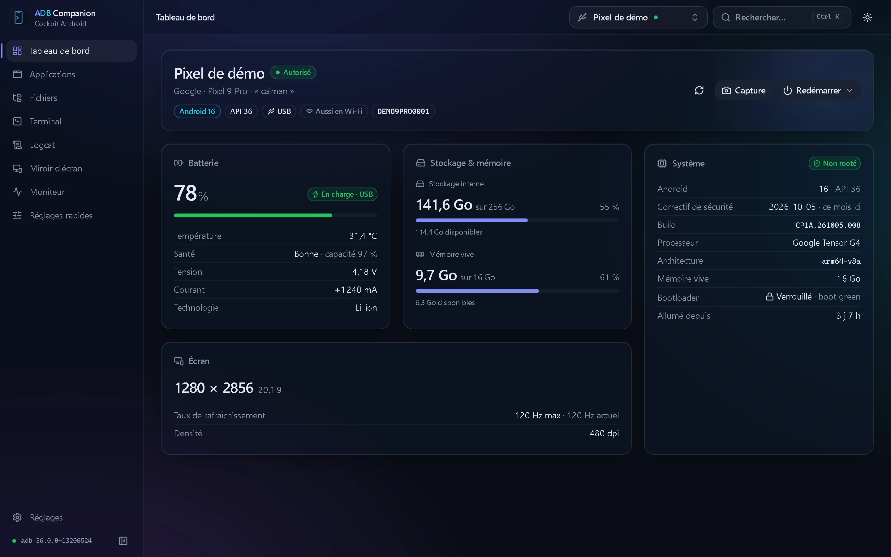

> [!NOTE]
> Les captures d'écran de cette page sont réalisées avec des appareils de démonstration fictifs.

## Sommaire

- [Fonctionnalités](#fonctionnalités)
- [Installation](#installation)
- [Premiers pas](#premiers-pas)
- [Visite guidée](#visite-guidée)
- [Mises à jour](#mises-à-jour)
- [Questions fréquentes](#questions-fréquentes)

## Fonctionnalités

| | |
|---|---|
| **Tableau de bord** | Batterie (niveau, santé, température, courant), stockage, mémoire, écran, version d'Android, correctif de sécurité, processeur, état du bootloader et du root. Capture d'écran à enregistrer ou copier, redémarrage en mode normal, recovery, bootloader, fastbootd ou EDL. |
| **Applications** | Liste complète avec icônes, tailles et filtres (utilisateur, système, désactivées, désinstallées). Installation d'APK, d'APKS et de XAPK (avec données OBB) par glisser-déposer. Lancer, arrêter, désactiver, vider le cache ou les données, désinstaller, restaurer une application système. Actions par lots, permissions modifiables. |
| **Fichiers** | Explorateur à deux volets ordinateur ↔ appareil sur le protocole de synchronisation d'ADB. Transferts suivis et annulables, gestion des conflits (remplacer, ignorer, garder les deux), aperçu, glisser-déposer depuis l'explorateur du système, mode root. |
| **Terminal** | Shell interactif complet (couleurs, complétion, redimensionnement) en onglets, onglet root, macros intégrées et personnalisées. |
| **Logcat** | Journaux en direct et fluides, filtres par niveau, étiquette (avec exclusions), application ou expression régulière, vraie pause, effacement, export. |
| **Moniteur** | Processeur cœur par cœur, mémoire, températures et batterie en temps réel sur 1 à 30 minutes. Gestionnaire de processus : tri, recherche, arrêt, libération de mémoire. |
| **Miroir d'écran** | Affichage et contrôle de l'appareil avec [scrcpy](https://github.com/Genymobile/scrcpy), installé et réglé pour vous : définition, débit, codec, écran éteint, enregistrement. Profil allégé en Wi-Fi, repli automatique si l'encodeur vidéo de l'appareil échoue. |
| **Sans fil** | Appairage par QR code ou par code, découverte automatique des appareils, connexion par adresse, passage USB → Wi-Fi en un clic, reconnexion automatique, indicateur de connexion instable. Un appareil branché en USB et en Wi-Fi n'apparaît qu'une fois. |
| **Réglages rapides** | Vitesse des animations, définition et densité de l'écran, rester éveillé, afficher les touches, DNS privé, thème sombre, assombrissement forcé — avec retour aux valeurs d'origine en un clic. |
| **Confort** | Palette de commandes <kbd>Ctrl</kbd>+<kbd>K</kbd>, icône dans la zone de notification, notifications de connexion, ADB téléchargé automatiquement si absent, thème sombre ou clair avec effet verre, mises à jour signées. |

## Installation

Téléchargez la version adaptée à votre système depuis le [site](https://alexcmb.github.io/adbcompanion-releases/#telecharger) ou la [page des versions](https://github.com/alexcmb/adbcompanion-releases/releases) :

| Système | Fichier | Remarque |
|---|---|---|
| Windows 10 / 11 (64 bits) | `ADB.Companion_<version>_x64-setup.exe` | Recommandé. Installation portable : toutes les données dans le dossier de l'application. |
| | `ADB.Companion_<version>_x64_fr-FR.msi` | Pour un déploiement en entreprise. |
| macOS 11+ Apple Silicon | `ADB.Companion_<version>_aarch64.dmg` | Mac M1 et suivants. |
| macOS 11+ Intel | `ADB.Companion_<version>_x64.dmg` | |
| Linux x86_64 | `ADB.Companion_<version>_amd64.AppImage` | Toutes distributions. |
| | `.deb` / `.rpm` | Debian, Ubuntu… / Fedora, openSUSE… |

> [!IMPORTANT]
> L'application n'est pas encore signée par un certificat de développeur.
> - **Windows** : SmartScreen affiche « Windows a protégé votre ordinateur » → *Informations complémentaires* → *Exécuter quand même*.
> - **macOS** : clic droit sur l'application → *Ouvrir*, puis confirmer.
>
> Les mises à jour, elles, sont signées et vérifiées par l'application avant d'être installées.

Rien d'autre à installer : ADB Companion utilise un ADB déjà présent (Android SDK, `PATH`…) ou propose de télécharger les Platform-Tools officiels de Google en un clic.

## Premiers pas

1. Sur l'appareil Android : **Paramètres → À propos du téléphone**, touchez sept fois **Numéro de build** pour afficher les *Options pour les développeurs*.
2. Dans les *Options pour les développeurs*, activez **Débogage USB** (et **Débogage sans fil** pour une connexion Wi-Fi).
3. Branchez l'appareil et acceptez la clé de l'ordinateur sur son écran. Il apparaît aussitôt dans ADB Companion.

Pour passer en Wi-Fi : bouton **Passer en Wi-Fi** sur le tableau de bord d'un appareil branché en USB, ou **Connexion sans fil → QR code** et scannez le code depuis *Débogage sans fil → Associer l'appareil avec un code QR* (Android 11 et plus).

## Visite guidée

### Applications

Installez par glisser-déposer, agissez sur une ou plusieurs applications à la fois.

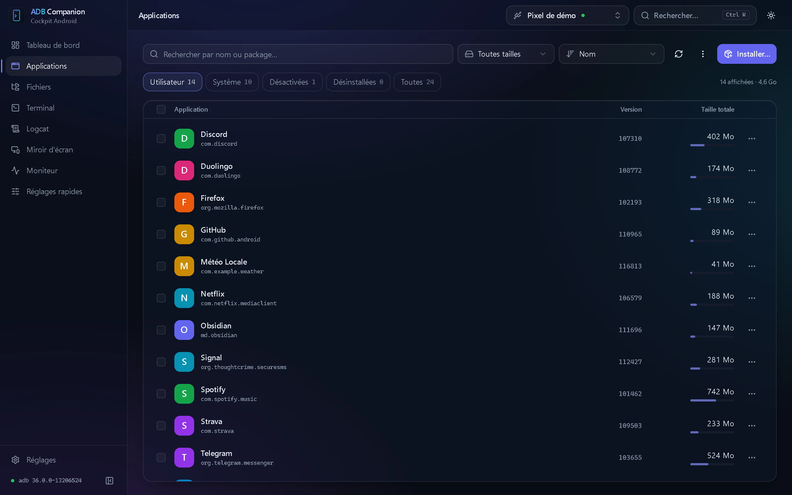

### Fichiers

Deux volets, des transferts rapides et suivis.

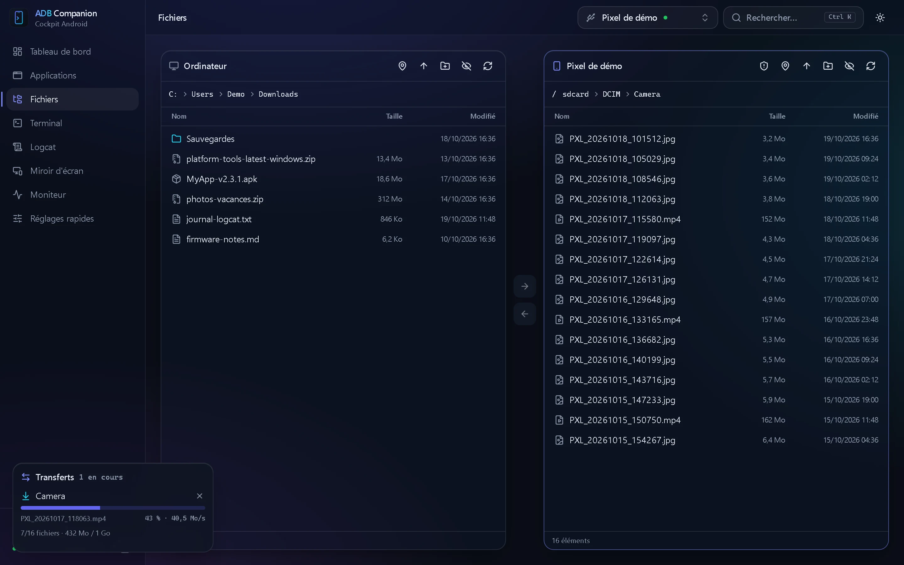

### Terminal

Un vrai shell, en onglets, avec macros.

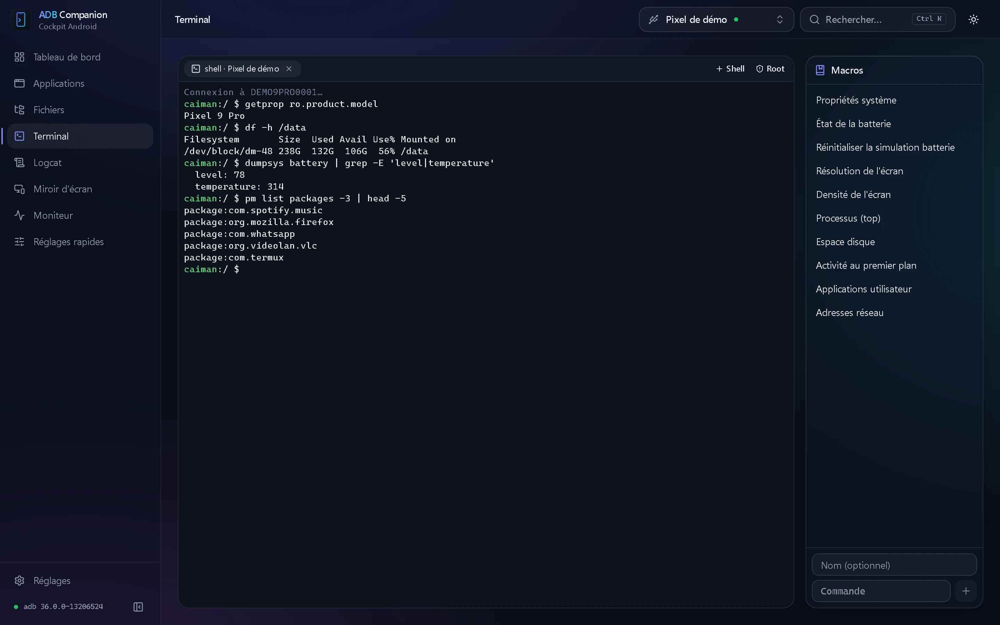

### Logcat

Des journaux lisibles même à fort débit, filtrables à volonté.

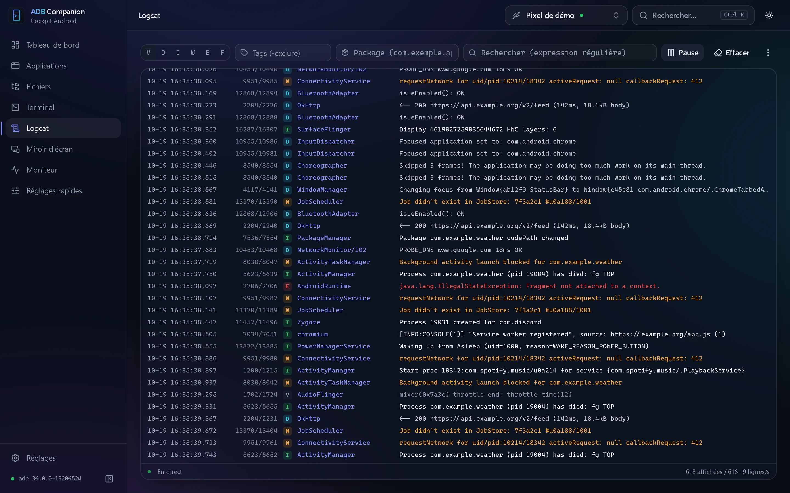

### Moniteur

Processeur, mémoire, températures et batterie en temps réel.

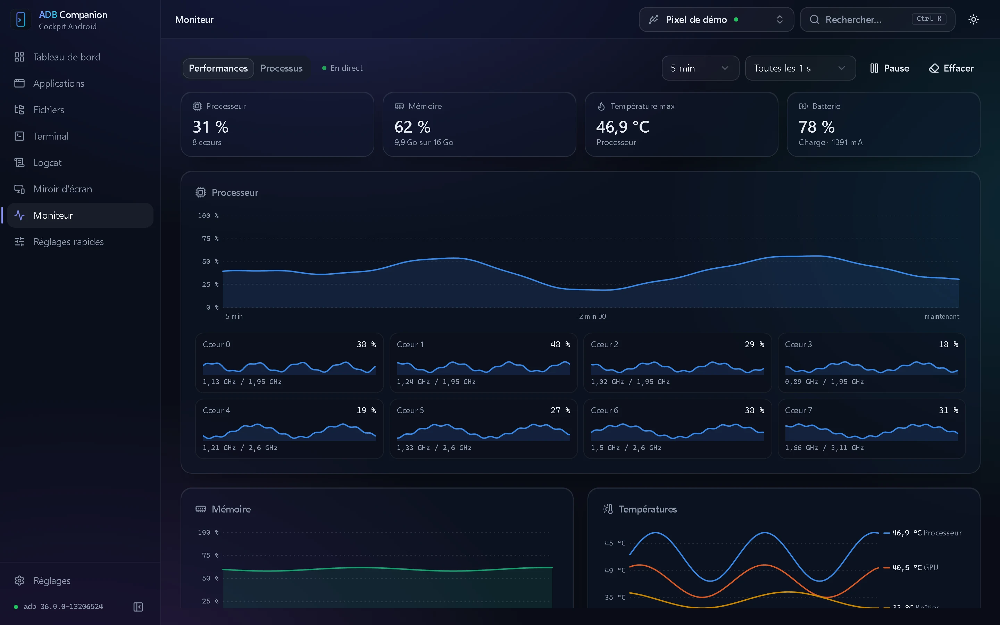

### Connexion sans fil

Appairage par QR code, sans adresse ni port à retenir.

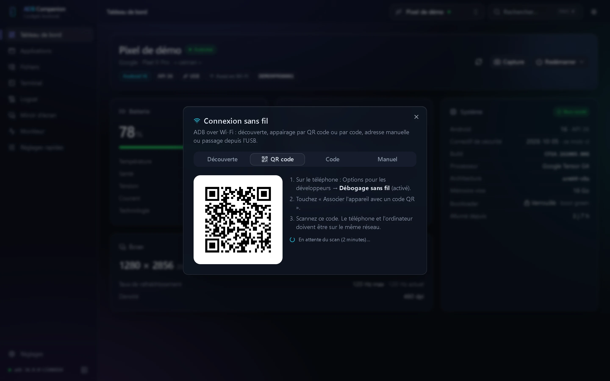

### Miroir d'écran

L'écran de l'appareil dans une fenêtre, réglé pour vous.

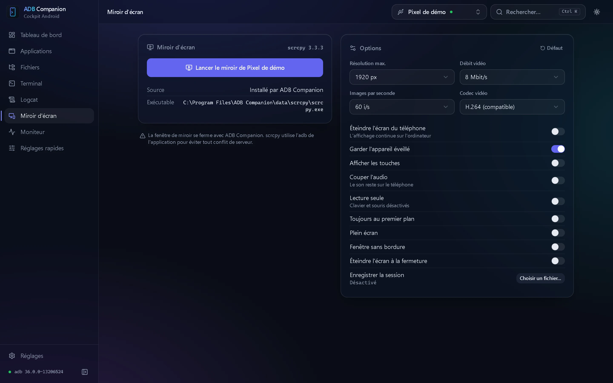

### Réglages rapides

Les options cachées d'Android, avec retour en arrière.

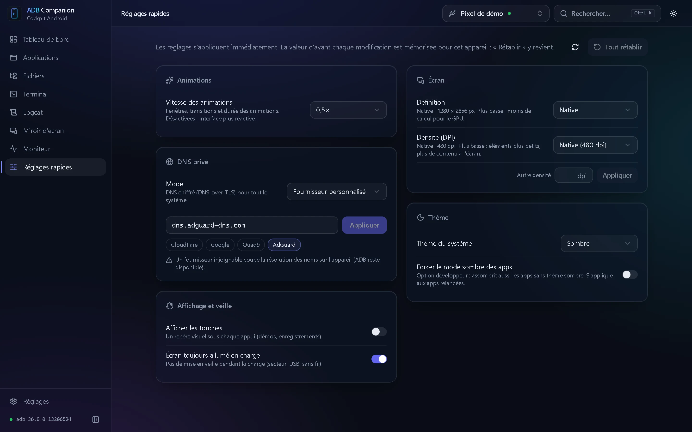

### Palette de commandes et thème clair

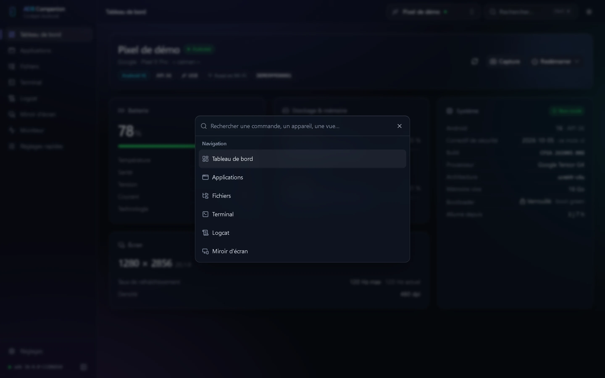 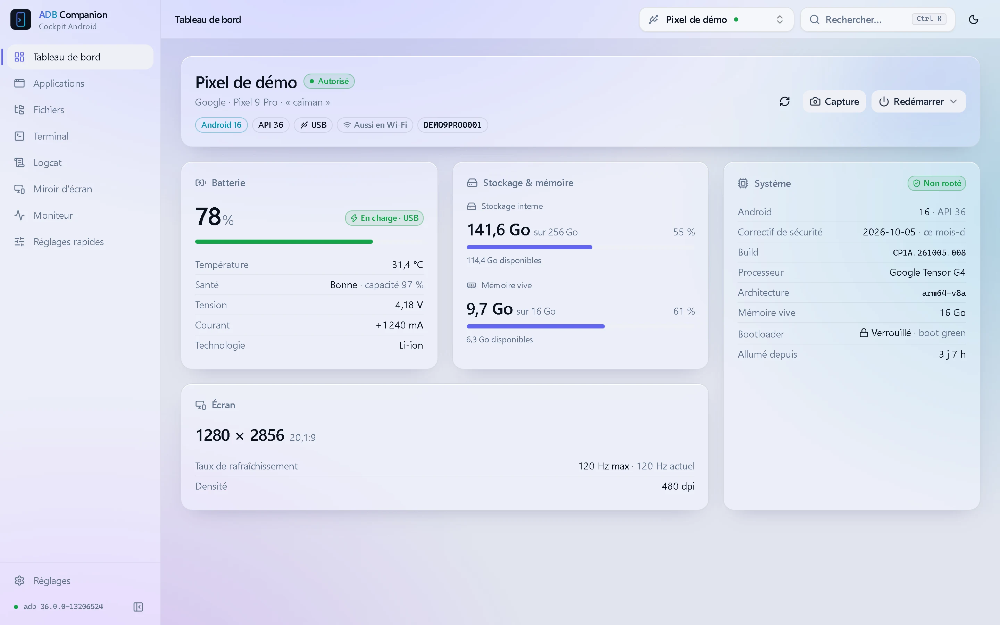

## Mises à jour

ADB Companion vérifie au démarrage si une nouvelle version est disponible ; rien n'est installé sans votre accord, et chaque paquet est vérifié par signature.
Dans **Réglages → Mises à jour**, l'option **Versions expérimentales** permet de recevoir aussi les pré-versions publiées pour test.

## Questions fréquentes

<b>Faut-il un appareil rooté ?</b>

Non. Le root n'est utilisé que pour quelques fonctions avancées (explorateur de tout le système de fichiers, onglet root du terminal, vidage du cache d'une application), lorsque votre gestionnaire de root l'accorde au shell.

<b>Où sont rangées mes données ? Des informations sont-elles envoyées ?</b>

Sous Windows, l'installation est portable : réglages, journaux et outils téléchargés sont dans un dossier `data` à côté de l'application ; l'installeur propose de le supprimer à la désinstallation.
L'application n'envoie aucune donnée. Elle ne contacte Internet que pour vérifier les mises à jour et, à votre demande, télécharger ADB ou scrcpy.

<b>Linux : l'appareil n'apparaît pas en USB.</b>

Installez les règles udev Android de votre distribution (souvent `android-udev-rules` ou `android-sdk-platform-tools-common`), ajoutez votre utilisateur au groupe indiqué (`plugdev` ou `adbusers`), puis rebranchez l'appareil.

<b>L'appareil apparaît « non autorisé ».</b>

Déverrouillez l'appareil et acceptez la demande « Autoriser le débogage USB ? ». Si elle n'apparaît pas, révoquez les autorisations de débogage dans les *Options pour les développeurs*, puis rebranchez.

<b>Le miroir d'écran reste noir sur mon téléviseur.</b>

Certains encodeurs vidéo de téléviseurs ne supportent pas les hautes définitions. ADB Companion relance automatiquement le miroir avec une définition plus basse ou un autre encodeur, et mémorise le réglage qui fonctionne pour cet appareil.

---

Ce dépôt héberge les versions publiées d'ADB Companion et son site. Miroir d'écran propulsé par <a href="https://github.com/Genymobile/scrcpy">scrcpy</a>.

